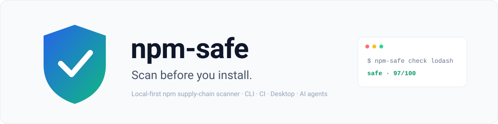
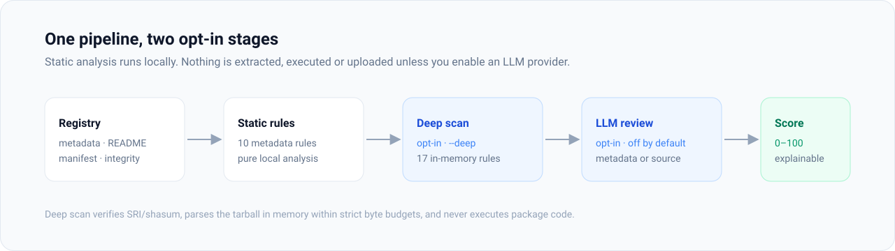
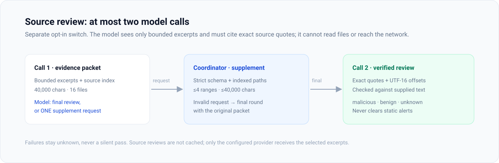
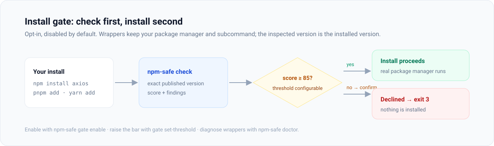
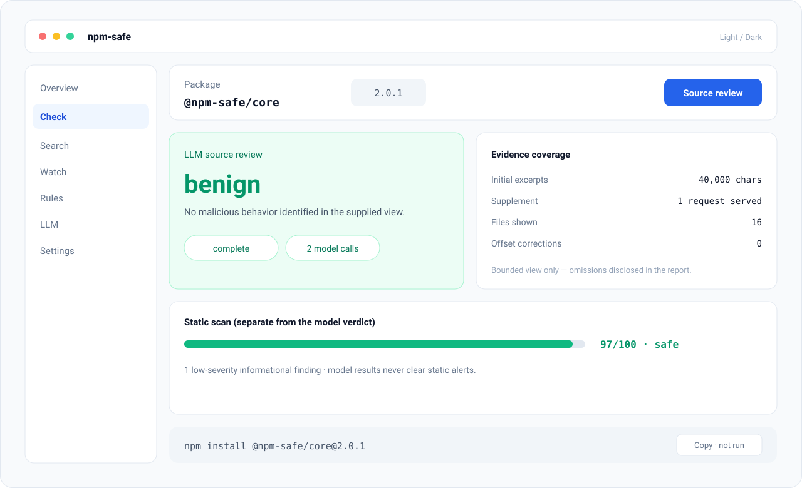

<div align="center">

<picture>
  <source media="(prefers-color-scheme: dark)" srcset="docs/assets/banner-dark.svg">
  
</picture>

# npm-safe

**Scan before you install.** A local-first npm supply-chain scanner for the
command line, CI, desktop, and AI coding agents.

[](https://www.npmjs.com/package/@npm-safe/core)
[](https://github.com/nisconder/npm-safe/actions)
[](./LICENSE)
[](https://nodejs.org)

[Quick start](#quick-start) · [Features](#features) · [Security model](#security-model) · [CLI reference](docs/cli.md) · [Docs](#documentation) · [中文版](README_zh.md)

</div>

---

`npm-safe` checks published metadata and README signals by default; an opt-in
deep scan also verifies and inspects the shipped tarball for dangerous archive
structure, executable content, obfuscation, process execution, networking, and
sensitive environment access. Every run returns an explainable 0–100 security
score. Static analysis and caching run locally with no account or hosted
backend; optional LLM analysis is disabled by default.

> **2.0** adds optional LLM **source review** behind a separate, default-off
> switch (upgrades preserve that default), and complete scans with High
> findings are now at least `suspicious`. If you consume scan levels in scripts
> or CI, review the [2.0 upgrade notes](CHANGELOG.md#200---2026-11-12).

## Why npm-safe?

`npm audit` is excellent at finding published vulnerabilities in known
dependency versions. npm-safe complements it by looking for **supply-chain
attack signals** before or during installation:

- **Local-first.** No account, no hosted backend; analysis and caching stay on your machine.
- **Bounded and inert.** Deep scans parse tarballs in memory within strict byte budgets — never extracted, never executed.
- **Opt-in intelligence.** LLM analysis is off by default; source review has its own switch. Model results can never clear static alerts or raise the static score.
- **Explainable.** 10 metadata rules + 17 deep-scan rules, all documented, configurable, and extensible with local plugins.

<picture>
  <source media="(prefers-color-scheme: dark)" srcset="docs/assets/pipeline-dark.svg">
  
</picture>

| Use case | Command | What you get |
|---|---|---|
| Check before choosing | `npm-safe check <package>` | Findings, explanations, security score |
| Guard an install | `npm-safe install <package>` | Opt-in confirmation gate below your threshold |
| Protect a project | `npm-safe ci --lockfile` | Direct + transitive scanning with CI exit codes |
| Compare releases | `npm-safe diff <pkg> 1.0.0 1.1.0` | Added/removed/persisting evidence across two exact versions |
| Review visually | [Desktop app](#desktop) | Red/yellow/green risk card and a pinned install command |
| Guard AI agents | `npm-safe skill install` | A safety skill for Codex, Claude Code, Gemini CLI, and more |

## Quick start

Requires Node.js 20.12+.

```bash
npx @npm-safe/core check lodash          # metadata + README signals
npx @npm-safe/core check lodash --deep   # verify + inspect published contents
```

Or install globally / as a library:

```bash
npm install -g @npm-safe/core && npm-safe check lodash
```

```ts
import { NpmSafeEngine } from "@npm-safe/core";

const engine = new NpmSafeEngine();
const result = await engine.checkPackage("lodash");
console.log(result.security.overallLevel, result.security.overallScore);
engine.close();
```

Illustrative metadata-only output (versions and findings can change):

```text
Package: lodash
Security level: safe
Score: 97/100
Findings: 1 low-severity informational signal
```

`safe` can still include Medium or Low findings; complete scans with High
findings are at least `suspicious`. The score is not a probability of safety —
see [Security model](#security-model).

## Features

### Deep scan

`--deep` downloads the selected version's tarball from the configured registry,
verifies npm SRI/`shasum` metadata when present, parses the archive entirely in
memory, and reports file paths and line numbers for high-confidence findings.
It never extracts package files or executes package code.

| Limit | Value |
|---|---|
| Compressed archive | 20 MiB |
| Unpacked archive | 50 MiB |
| Archive entries | 5,000 |
| Per text file | 4 MiB |
| Total text inspected | 8 MiB |

Tarball URLs and redirects must remain on the configured registry origin.
Reaching a limit produces a visible partial result; `ci --deep` fails closed
when any requested deep scan is partial or unavailable.

```bash
npm-safe check lodash --deep
npm-safe ci --lockfile --deep
npm-safe install axios --deep --dry-run
```

### LLM analysis and source review

LLM-based semantic scanning is optional and disabled by default; without an
API key, static analysis continues normally. Providers: OpenAI, Gemini,
Anthropic. Configuration persists in `~/.npm-safe/llm.json` and can also come
from `OPENAI_API_KEY`, `GEMINI_API_KEY`, or `ANTHROPIC_API_KEY`.

```bash
npm-safe llm enable
npm-safe llm set-provider openai
npm-safe llm set-key $OPENAI_API_KEY
npm-safe llm set-model gpt-4o-mini
npm-safe llm test-connection
```

**Source review** (2.0) has a separate switch, off by default. On a deep check
it replaces the metadata-only model call: the model reviews bounded source
excerpts from the same verified tarball and must cite exact quotes with
original-file UTF-16 offsets. It may request one supplement; the coordinator
enforces strict schemas, indexed paths, and character budgets. At most two
model calls.

<picture>
  <source media="(prefers-color-scheme: dark)" srcset="docs/assets/source-review-dark.svg">
  
</picture>

```bash
npm-safe llm enable-source
npm-safe check lodash --deep
```

Only the configured provider receives the selected excerpts; latency and model
charges increase. Reports retain exact evidence, omissions, and `unknown`
outcomes. Model results cannot clear static alerts or raise the static score;
requested review failures make an otherwise safe result `unknown`. Source
reviews are not cached. [Behavior and limits →](docs/source-review.md)

### Install gate

Opt-in and disabled by default. Once enabled, every target package is checked
first; anything scoring **below the threshold (default 85)** requires manual
confirmation before the install proceeds. The inspected version is the
installed version.

<picture>
  <source media="(prefers-color-scheme: dark)" srcset="docs/assets/install-gate-dark.svg">
  
</picture>

```bash
npm-safe gate enable            # installs shell wrappers + PATH shims
npm-safe gate set-threshold 90
npm-safe install axios          # gated install (prompts below threshold)
npm-safe install axios --yes    # auto-confirm
npm-safe install axios --dry-run
npm-safe doctor                 # diagnose wrappers / PATH
```

- Wrappers retain your manager and subcommand: `pnpm install` stays an install, `yarn add` stays an add. A bare install scans direct manifest dependencies and always confirms.
- EOF declines confirmation with exit code 3. The enabled gate rejects sources and registry configurations it cannot inspect.
- Put package-manager options after `--` when they overlap gate options (`npm-safe install -- lodash --dry-run`); the gate's own `--yes` must appear before the separator.
- `gate enable` installs PATH shims into `~/.npm-safe/bin` and appends wrapper functions to your shell profile (PowerShell `$PROFILE`, `~/.zshrc`/`~/.bashrc`). Persistent Windows PATH changes require explicit `gate shell --user` or `--machine` (admin); `npm-safe doctor` verifies resolution. Remove everything with `gate shell --remove`.

The gate shares its settings with the desktop GUI, so CLI and GUI toggles stay
in sync. [Full gate reference →](docs/cli.md#install-gate-opt-in)

### CI/CD

`npm-safe ci` scans a project's dependencies and fails the build when any
dependency reaches a configurable security level:

```bash
npm-safe ci --dir ./packages/core      # default fail level: dangerous
npm-safe ci --fail-level suspicious    # stricter gate
npm-safe ci --prod                     # skip devDependencies
npm-safe ci --lockfile                 # all lockfile deps (incl. transitive)
npm-safe ci --lockfile --deep          # inspect tarballs; fail closed if incomplete
npm-safe ci --json --rate-limit 50
```

Exit codes: `0` pass · `1` usage/config error · `2` a dependency reached the
fail level or the scan errored. Critical findings always block, even at a high
numerical score; unknown packages and incomplete deep scans fail closed.
Lockfile scans check each distinct name at its exact locked version; production
mode follows dependencies, optional dependencies, and installed peers through
the locked tree. Unsupported local/Git/custom-registry archives stop the scan
with an error instead of substituting the latest public package.

A ready-to-use workflow lives at
[`examples/github-actions/npm-safe.yml`](examples/github-actions/npm-safe.yml).

### Rules and plugins

Ten metadata rules and seventeen opt-in content rules detect install scripts,
obfuscation, typosquatting, secret exposure, unsafe archives, executable
content, process/network combinations, and more. Configuration persists in
`~/.npm-safe/rules.json`:

```bash
npm-safe rules list
npm-safe rules disable install-script
npm-safe rules severity typosquatting critical
```

Third-party plugins are ES module files (`*.mjs` / `*.js`) dropped into
`~/.npm-safe/rules/`, loaded at engine startup; bad files are skipped. Each
file may export `rule`, `rules`, or `default` conforming to `ScanRule`:

```js
// ~/.npm-safe/rules/my-rule.mjs
export const rule = {
  id: "my-rule",
  name: "My rule",
  description: "Detects something bad",
  severity: "high",
  category: "informational",
  enabled: true,
  match(readme, packageJson) {
    return packageJson?.scripts?.postinstall?.includes("wget")
      ? [{ ruleId: "my-rule", ruleName: "My rule", severity: "high",
           message: "postinstall uses wget", category: "informational" }]
      : [];
  },
};
```

The full rule API (`registerRule`, `unregisterRule`, `listRules`,
`setRuleEnabled`, `setRuleSeverity`) is exported from `@npm-safe/core`.
[Rule reference →](packages/core/SCANNER_RULES.md)

### Release diff

`npm-safe diff <package> <from> <to> --json` compares two exact published
releases with the same static rules, retaining added, removed, and persisting
evidence, registry-manifest changes, and both deep-scan reports. Incomplete
scans produce an inconclusive comparison instead of claiming a finding
disappeared. [Release diff and exit codes →](docs/release-diff.md)

### Batch, reports, history

```bash
npm-safe check lodash express axios          # concurrent batch (default 5)
npm-safe check --file deps.txt --concurrency 10
npm-safe check detail 2                      # re-render the 2nd package of the last batch
npm-safe report --format csv lodash express  # JSON/CSV export, stdout or file
npm-safe report --batch
```

Every CLI and desktop check is written to the shared SQLite database
(`~/.npm-safe/npm-safe.db`, `check_history`, newest-first, capped at 1000), so
packages scanned on the command line appear in the desktop dashboard and vice
versa. Programmatic access: `engine.getCheckHistory()`,
`engine.recordCheckHistory()`, `engine.clearCheckHistory()`.

### Proxy, telemetry, command log

- **Proxy** resolution order: `--proxy` flag > persisted `proxy` setting > `HTTPS_PROXY`/`HTTP_PROXY`/`ALL_PROXY`; `NO_PROXY` bypasses. `npm-safe settings set proxy http://127.0.0.1:7897`.
- **Telemetry** is local and opt-in (disabled by default, nothing is sent anywhere): `npm-safe telemetry enable|status|export|reset`, stored in `~/.npm-safe/telemetry.json`.
- **Command log**: every CLI invocation appends one JSONL line to `~/.npm-safe/commands.jsonl` (`timestamp, command, argv, exitCode, durationMs`). API keys, proxy credentials, and tokens are replaced with `[REDACTED]`; the file is restricted to the current user where supported. Redirect with `NPM_SAFE_COMMAND_LOG`.

## Desktop

A portable Neutralinojs app (Material You dashboard, light/dark themes)
distributed as a ZIP on each [GitHub Release](https://github.com/nisconder/npm-safe/releases) —
unzip and run; Node.js and the engine are bundled. Upgrading from older
versions requires downloading the complete ZIP once; replacing only
`resources.neu` cannot update the bundled runtime.

- **Overview**: average-score gauge, recent checks, 7-day histogram, risk breakdown.
- **Check / Search / Watch**: scan packages, search the registry, manage and refresh the watchlist.
- **Rules / LLM / Settings**: toggle rules and severities, configure providers with a connection test, read/write engine settings including the install gate.
- **Risk card**: red/yellow/green installation risk for npm packages and public GitHub repositories; ordinary packages vs DSH plugins identified automatically (manual override available). npm tarballs get integrity verification; DSH plugins also get bundle, shipped-patch, host-dependency, and peer checks. Generates a version- or commit-pinned command **without running it**.

<picture>
  <source media="(prefers-color-scheme: dark)" srcset="docs/assets/desktop-dark.svg">
  
</picture>

<sub>Illustrative UI mockup in the README visual style; the app never executes installations from this screen. An <a href="docs/assets/npm-safe-desktop.png">actual desktop screenshot</a> of a live source review remains available.</sub>

> **Windows first run:** if the WebView2 window fails with a loopback error, run once in an administrator PowerShell:
> `CheckNetIsolation.exe LoopbackExempt -a -n="Microsoft.Win32WebViewHost_cw5n1h2txyewy"`.

[Desktop README →](packages/desktop/README.md) · [Build instructions →](CONTRIBUTING.md#desktop-gui-build)

## AI skill

The `npm-safe-scan` skill ships with the package but is **never installed
automatically** — installing `@npm-safe/core` runs no postinstall hook and
writes no agent configuration. It lets agents invoke npm-safe as a
"check before you install" safety gate.

```bash
npm-safe skill install                          # generic ~/.agents/skills/
npm-safe skill install --agent codex,claude-code
npm-safe skill status                           # per-agent status
npm-safe skill uninstall
npm-safe skill                                  # interactive wizard
```

| Agent | Install target | Kind |
|---|---|---|
| Generic | `~/.agents/skills/npm-safe-scan/SKILL.md` | skill |
| Claude Code | `~/.claude/skills/npm-safe-scan/SKILL.md` | skill |
| Codex | `~/.codex/AGENTS.md` | instructions |
| Gemini CLI | `~/.gemini/GEMINI.md` | instructions |
| OpenCode | `~/.config/opencode/AGENTS.md` | instructions |
| Trae / Qoder / Zcode | `~/.trae|.qoder|.zcode/skills/npm-safe-scan/SKILL.md` | skill |

## Security model

npm-safe is an early-warning heuristic, **not a safety certification**. The
default scan inspects registry metadata, the selected manifest, and README;
`--deep` additionally verifies and heuristically inspects the shipped tarball
within strict resource limits.

| Level | Meaning |
|---|---|
| `safe` | Score 80–100, no High/Critical finding, complete scan |
| `suspicious` | Score ≥ 50, or any High finding on a complete scan |
| `dangerous` | Any Critical finding, or score < 50 |
| `unknown` | Incomplete scan without established danger |

Score = 100 minus severity weights (Critical 25 · High 15 · Medium 8 · Low 3).
Medium/Low findings may appear in a `safe` report; neither the score nor the
label is a probability or guarantee of runtime safety. False positives and
missed detections are possible — passing the automated tests establishes
tested behavior, not real-world detection accuracy. Use npm-safe alongside
vulnerability databases, lockfiles, code review, and least-privilege builds.

[Threat model →](docs/THREAT_MODEL.md) · [Evaluation reports →](docs/evaluation.md) · [Security policy →](SECURITY.md)

## Architecture

Five layers, each depending only on the layers below; the `index.ts` facade
composes them into a single `NpmSafeEngine` class (29 public methods).

```text
                        +------------------------+
                        |        index.ts        |
                        |   NpmSafeEngine facade |
                        +-----------+------------+
              +---------------------+---------------------+
              |                     |                     |
     +--------v--------+   +--------v--------+   +--------v--------+
     |     Registry    |   |     Scanner     |   |    Scheduler    |
     | client/validator|   | StaticAnalyzer  |   | RefreshScheduler|
     | (HTTP fetch)    |   | 10 rules, pure  |   | TokenBucket     |
     +--------+--------+   +--------+--------+   +--------+--------+
              +---------------------+---------------------+
                        +-----------v------------+
                        |         Store          |
                        | DatabaseManager/Cache  |
                        | SQLite (WAL)           |
                        +------------------------+
```

| Layer | Role |
|---|---|
| **Registry** | HTTP communication with the npm registry; name/version validation; registry-facing types. |
| **Scanner** | Pure static analysis of metadata/README; rule config overrides and plugin discovery. No network during analysis. |
| **Scheduler** | Periodic refresh of watched packages; token bucket (5 tokens/s, 10 burst) limits registry frequency. |
| **Store** | better-sqlite3 with WAL; migrations, TTL caching of metadata/reports, watchlist, key-value settings. |
| **Facade** | `NpmSafeEngine`: checks, search, watchlist, refresh, settings, rules, LLM configuration, lifecycle. |

A sixth auxiliary **Translator** layer provides a pluggable translation
interface; it is typed and importable but not wired into the scan pipeline.
[Full architecture →](packages/core/ARCHITECTURE.md)

### Key design decisions

| Decision | Rationale |
|---|---|
| ESM-only, strict TypeScript, no `any` | Modern Node ecosystem; fully typed public surface. |
| 250-LOC ceiling per module | Focused, reviewable files; only the facade modestly exceeds it. |
| Pure static analysis, no network | The scanner inspects only already-fetched metadata/README text. |
| Cache-first with scanner fingerprint | Changed rules/severity invalidate cached reports; metadata TTL 1 h. |
| String enums for levels/severities | Safe to log, serialize, and switch on. |
| One shared level policy | Live scans, cached reports, engine, and CI agree; LLM cannot raise the static score. |

## Configuration and data

Everything lives under `~/.npm-safe/`:

| Path | Purpose |
|---|---|
| `npm-safe.db` | SQLite: cache, watchlist, settings, shared check history |
| `llm.json` | LLM provider configuration (keys redacted in logs) |
| `rules.json` | Rule enablement/severity overrides |
| `rules/` | Local rule plugins (`*.mjs` / `*.js`) |
| `telemetry.json` | Opt-in local telemetry |
| `commands.jsonl` | Redacted command log |
| `last-batch.json` | Most recent batch check |
| `bin/` | Install-gate PATH shims |

Environment: `OPENAI_API_KEY` / `GEMINI_API_KEY` / `ANTHROPIC_API_KEY`,
`HTTPS_PROXY` / `HTTP_PROXY` / `ALL_PROXY` / `NO_PROXY`,
`NPM_SAFE_COMMAND_LOG`.

## Documentation

| Topic | Link |
|---|---|
| Full CLI reference | [docs/cli.md](docs/cli.md) |
| Source review behavior & limits | [docs/source-review.md](docs/source-review.md) |
| Release diff & exit codes | [docs/release-diff.md](docs/release-diff.md) |
| Threat model | [docs/THREAT_MODEL.md](docs/THREAT_MODEL.md) |
| Scanner evaluation & splits | [docs/evaluation.md](docs/evaluation.md) · [docs/evaluation-splits.md](docs/evaluation-splits.md) |
| Architecture & design decisions | [packages/core/ARCHITECTURE.md](packages/core/ARCHITECTURE.md) |
| Public API | [packages/core/API.md](packages/core/API.md) |
| Rule reference | [packages/core/SCANNER_RULES.md](packages/core/SCANNER_RULES.md) |
| Desktop app | [packages/desktop/README.md](packages/desktop/README.md) |
| Contributing | [CONTRIBUTING.md](CONTRIBUTING.md) |
| Changelog / Roadmap / Security policy | [CHANGELOG](CHANGELOG.md) · [ROADMAP](ROADMAP.md) · [SECURITY](SECURITY.md) |

## Acknowledgements

Weifang Leimingyun Network Technology Co., Ltd. provided the AI automatic
promotion tool Bizbot (http://bizbot.zvo.cn) for this project.

Questions and collaboration: 1031402408@qq.com.

## License

Apache-2.0. See [LICENSE](LICENSE).