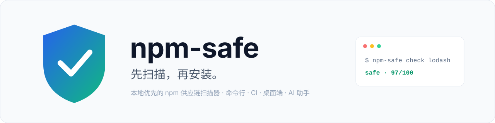
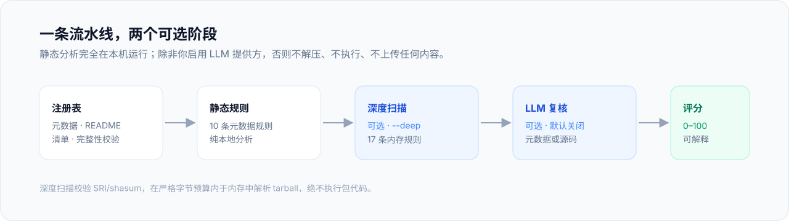
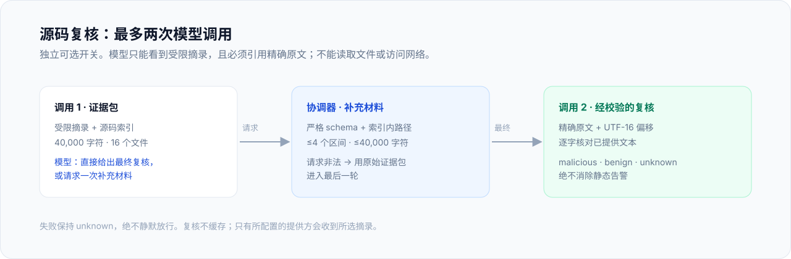
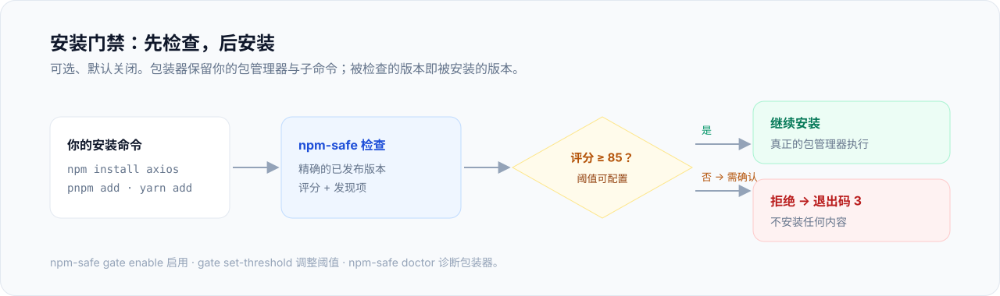
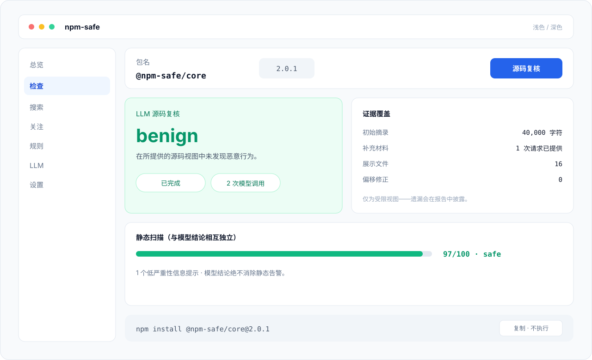

<div align="center">

<picture>
  <source media="(prefers-color-scheme: dark)" srcset="docs/assets/banner-zh-dark.svg">
  
</picture>

# npm-safe

**先扫描，再安装。** 本地优先的 npm 供应链安全扫描器，覆盖命令行、CI、桌面端与 AI 编程助手。

[](https://www.npmjs.com/package/@npm-safe/core)
[](https://github.com/nisconder/npm-safe/actions)
[](./LICENSE)
[](https://nodejs.org)

[快速开始](#快速开始) · [功能特性](#功能特性) · [安全模型](#安全模型) · [命令参考](docs/cli.md) · [文档](#文档) · [English](README.md)

</div>

---

`npm-safe` 默认检查已发布的元数据与 README 信号；可选的深度扫描还会校验并检查随包发布的 tarball，识别危险归档结构、可执行内容、混淆、进程执行、网络行为与敏感环境访问。每次运行都给出可解释的 0–100 安全评分。静态分析与缓存全部在本机完成，无需账号、无托管后端；LLM 分析默认关闭、按需启用。

> **2.0** 新增可选的 LLM **源码复核**，使用独立的默认关闭开关（升级保留该默认值）；完整扫描若含 High 发现，等级至少为 `suspicious`。若你的脚本或 CI 消费扫描等级，请阅读 [2.0 升级说明](CHANGELOG.md#200---2026-11-12)。

## 为什么选择 npm-safe？

`npm audit` 擅长发现已知依赖版本的已公开漏洞；npm-safe 与之互补，在安装前或安装时捕捉**供应链攻击信号**：

- **本地优先。** 无需账号、无托管后端，分析与缓存留在你的机器上。
- **受限且惰性。** 深度扫描在严格字节预算内于内存中解析 tarball——绝不解压、绝不执行。
- **智能可选。** LLM 分析默认关闭；源码复核另有独立开关。模型结论永远不能消除静态告警或抬高静态分数。
- **可解释。** 10 条元数据规则 + 17 条深度扫描规则，全部有文档、可配置，并支持本地插件扩展。

<picture>
  <source media="(prefers-color-scheme: dark)" srcset="docs/assets/pipeline-zh-dark.svg">
  
</picture>

| 场景 | 命令 | 得到什么 |
|---|---|---|
| 选包前检查 | `npm-safe check <package>` | 发现项、解释、安全评分 |
| 守护安装 | `npm-safe install <package>` | 低于阈值时可选的确认门禁 |
| 保护项目 | `npm-safe ci --lockfile` | 直接 + 传递依赖扫描，CI 退出码 |
| 对比版本 | `npm-safe diff <pkg> 1.0.0 1.1.0` | 两个精确版本间新增/消失/持续的证据 |
| 可视化复核 | [桌面端](#桌面端) | 红/黄/绿安装风险卡与锁定版本的安装命令 |
| 守护 AI 助手 | `npm-safe skill install` | 面向 Codex、Claude Code、Gemini CLI 等的安全技能 |

## 快速开始

需要 Node.js 20.12+。

```bash
npx @npm-safe/core check lodash          # 元数据 + README 信号
npx @npm-safe/core check lodash --deep   # 校验并检查已发布内容
```

或全局安装 / 作为库使用：

```bash
npm install -g @npm-safe/core && npm-safe check lodash
```

```ts
import { NpmSafeEngine } from "@npm-safe/core";

const engine = new NpmSafeEngine();
const result = await engine.checkPackage("lodash");
console.log(result.security.overallLevel, result.security.overallScore);
engine.close();
```

示意性元数据输出（版本与发现项可能变化）：

```text
包名: lodash
安全等级: safe
分数: 97/100
发现项: 1 个低严重性信息提示
```

`safe` 仍可能包含 Medium/Low 发现；完整扫描含 High 发现时至少为 `suspicious`。分数不是安全概率——见[安全模型](#安全模型)。

## 功能特性

### 深度扫描

`--deep` 从所配置注册表下载所选版本的 tarball，存在 npm SRI/`shasum` 元数据时先行校验，完全在内存中解析归档，并为高置信度发现附带文件路径与行号。绝不解压包文件、绝不执行包代码。

| 限额 | 数值 |
|---|---|
| 压缩归档 | 20 MiB |
| 解压归档 | 50 MiB |
| 归档条目 | 5,000 |
| 单文本文件 | 4 MiB |
| 检查文本总量 | 8 MiB |

tarball 地址与重定向必须保持在所配置注册表同源。触及限额会给出可见的部分结果；`ci --deep` 对任何不完整或不可用的深度扫描一律失败关闭。

```bash
npm-safe check lodash --deep
npm-safe ci --lockfile --deep
npm-safe install axios --deep --dry-run
```

### LLM 分析与源码复核

基于 LLM 的语义扫描可选、默认关闭；未配置 API key 时静态分析照常运行。提供方：OpenAI、Gemini、Anthropic。配置持久化在 `~/.npm-safe/llm.json`，也可来自环境变量 `OPENAI_API_KEY`、`GEMINI_API_KEY`、`ANTHROPIC_API_KEY`。

```bash
npm-safe llm enable
npm-safe llm set-provider openai
npm-safe llm set-key $OPENAI_API_KEY
npm-safe llm set-model gpt-4o-mini
npm-safe llm test-connection
```

**源码复核**（2.0）使用独立开关、默认关闭。深度检查时它取代仅元数据的模型调用：模型复核同一份已校验 tarball 中的受限源码摘录，且必须引用带原始文件 UTF-16 偏移的精确原文。模型可请求一次补充材料；协调器强制执行严格 schema、索引内路径与字符预算。最多两次模型调用。

<picture>
  <source media="(prefers-color-scheme: dark)" srcset="docs/assets/source-review-zh-dark.svg">
  
</picture>

```bash
npm-safe llm enable-source
npm-safe check lodash --deep
```

只有所配置的提供方会收到所选摘录；延迟与模型费用会增加。报告保留精确证据、遗漏与 `unknown` 结果。模型结论不能消除静态告警或抬高静态分数；被请求的复核失败会使原本 safe 的结果变为 `unknown`。源码复核不缓存。[行为与限制 →](docs/source-review.md)

### 安装门禁

可选、默认关闭。启用后每个目标包都会先被检查；**低于阈值（默认 85）**的包需人工确认后才继续安装。被检查的版本即被安装的版本。

<picture>
  <source media="(prefers-color-scheme: dark)" srcset="docs/assets/install-gate-zh-dark.svg">
  
</picture>

```bash
npm-safe gate enable            # 安装 shell 包装器 + PATH shim
npm-safe gate set-threshold 90
npm-safe install axios          # 受门禁保护的安装（低于阈值时询问）
npm-safe install axios --yes    # 自动确认
npm-safe install axios --dry-run
npm-safe doctor                 # 诊断包装器 / PATH
```

- 包装器保留你的包管理器与子命令：`pnpm install` 仍是 install，`yarn add` 仍是 add。裸安装扫描清单直接依赖并一律要求确认。
- EOF 拒绝确认，退出码 3。启用后的门禁会拒绝它无法检查的来源与注册表配置。
- 包管理器选项与门禁选项重叠时放在 `--` 之后（`npm-safe install -- lodash --dry-run`）；门禁自己的 `--yes` 必须出现在分隔符之前。
- `gate enable` 将 PATH shim 安装到 `~/.npm-safe/bin`，并向 shell 配置追加包装函数（PowerShell `$PROFILE`、`~/.zshrc`/`~/.bashrc`）。Windows 持久 PATH 变更需显式 `gate shell --user` 或 `--machine`（管理员）；`npm-safe doctor` 验证解析顺序。`gate shell --remove` 移除全部。

门禁与桌面 GUI 共享设置，CLI 与 GUI 开关保持同步。[完整门禁参考 →](docs/cli.md#install-gate-opt-in)

### CI/CD

`npm-safe ci` 扫描项目依赖，任一依赖达到可配置的安全等级即令构建失败：

```bash
npm-safe ci --dir ./packages/core      # 默认失败等级：dangerous
npm-safe ci --fail-level suspicious    # 更严格的门禁
npm-safe ci --prod                     # 跳过 devDependencies
npm-safe ci --lockfile                 # 锁文件全部依赖（含传递）
npm-safe ci --lockfile --deep          # 检查 tarball；不完整即失败关闭
npm-safe ci --json --rate-limit 50
```

退出码：`0` 通过 · `1` 用法/配置错误 · `2` 有依赖达到失败等级或扫描出错。Critical 发现即使分数很高也一律阻断；未知包与不完整深度扫描失败关闭。锁文件扫描按每个不同包名的精确锁定版本检查；生产模式沿锁树跟踪 dependencies、optionalDependencies 与已安装 peers。不支持的本地/Git/自定义注册表归档会直接报错停止，而不是替换为最新公共包。

开箱即用的工作流：[`examples/github-actions/npm-safe.yml`](examples/github-actions/npm-safe.yml)。

### 规则与插件

10 条元数据规则与 17 条可选内容规则，检测安装脚本、混淆、仿冒包名、密钥泄露、不安全归档、可执行内容、进程/网络组合等。配置持久化在 `~/.npm-safe/rules.json`：

```bash
npm-safe rules list
npm-safe rules disable install-script
npm-safe rules severity typosquatting critical
```

第三方插件是放入 `~/.npm-safe/rules/` 的 ES 模块文件（`*.mjs` / `*.js`），引擎启动时加载，坏文件被跳过。每个文件可导出符合 `ScanRule` 的 `rule`、`rules` 或 `default`：

```js
// ~/.npm-safe/rules/my-rule.mjs
export const rule = {
  id: "my-rule",
  name: "My rule",
  description: "Detects something bad",
  severity: "high",
  category: "informational",
  enabled: true,
  match(readme, packageJson) {
    return packageJson?.scripts?.postinstall?.includes("wget")
      ? [{ ruleId: "my-rule", ruleName: "My rule", severity: "high",
           message: "postinstall uses wget", category: "informational" }]
      : [];
  },
};
```

完整规则 API（`registerRule`、`unregisterRule`、`listRules`、`setRuleEnabled`、`setRuleSeverity`）由 `@npm-safe/core` 导出。[规则参考 →](packages/core/SCANNER_RULES.md)

### 版本对比

`npm-safe diff <package> <from> <to> --json` 用同一套静态规则对比两个精确的已发布版本，保留新增/消失/持续的证据、注册表清单变化与两份深度扫描报告。不完整的扫描给出不确定结论，而不是声称某发现已消失。[版本对比与退出码 →](docs/release-diff.md)

### 批量、报告与历史

```bash
npm-safe check lodash express axios          # 并发批量（默认 5）
npm-safe check --file deps.txt --concurrency 10
npm-safe check detail 2                      # 重新渲染上次批量的第 2 个包
npm-safe report --format csv lodash express  # JSON/CSV 导出，标准输出或文件
npm-safe report --batch
```

每次 CLI 与桌面端检查都写入共享 SQLite 数据库（`~/.npm-safe/npm-safe.db`，`check_history`，最新优先，上限 1000），命令行扫过的包会出现在桌面仪表盘，反之亦然。编程接口：`engine.getCheckHistory()`、`engine.recordCheckHistory()`、`engine.clearCheckHistory()`。

### 代理、遥测与命令日志

- **代理**解析顺序：`--proxy` 参数 > 持久化 `proxy` 设置 > `HTTPS_PROXY`/`HTTP_PROXY`/`ALL_PROXY`；`NO_PROXY` 绕过。`npm-safe settings set proxy http://127.0.0.1:7897`。
- **遥测**本地、可选（默认关闭，不向任何地方发送）：`npm-safe telemetry enable|status|export|reset`，存于 `~/.npm-safe/telemetry.json`。
- **命令日志**：每次 CLI 调用向 `~/.npm-safe/commands.jsonl` 追加一行 JSONL（`timestamp, command, argv, exitCode, durationMs`）。API key、代理凭据与令牌替换为 `[REDACTED]`；平台支持时文件仅限当前用户。可用 `NPM_SAFE_COMMAND_LOG` 重定向。

## 桌面端

便携式 Neutralinojs 应用（Material You 仪表盘，浅/深双主题），以 ZIP 形式随每个 [GitHub Release](https://github.com/nisconder/npm-safe/releases) 分发——解压即用，内置 Node.js 与引擎。从旧版本升级需完整下载一次 ZIP；仅替换 `resources.neu` 无法更新内置运行时。

- **总览**：平均分仪表、最近检查、7 天直方图、风险分布。
- **检查 / 搜索 / 关注**：扫描包、搜索注册表、管理并刷新关注列表。
- **规则 / LLM / 设置**：开关规则与严重性、配置提供方并测试连接、读写引擎设置（含安装门禁）。
- **风险卡**：npm 包与公开 GitHub 仓库的红/黄/绿安装风险；自动区分普通包与 DSH 插件（可手动覆盖）。npm tarball 做完整性校验；DSH 插件另做 bundle、随附补丁、宿主依赖与 peer 检查。生成锁定版本或 commit 的命令而**不执行**。

<picture>
  <source media="(prefers-color-scheme: dark)" srcset="docs/assets/desktop-zh-dark.svg">
  
</picture>

<sub>与 README 视觉风格一致的界面示意图；此页面不会执行安装。仍可查看真实桌面端<a href="docs/assets/npm-safe-desktop.png">源码复核截图</a>。</sub>

> **Windows 首次运行：** 若 WebView2 窗口因 loopback 错误无法加载，请在管理员 PowerShell 中执行一次：
> `CheckNetIsolation.exe LoopbackExempt -a -n="Microsoft.Win32WebViewHost_cw5n1h2txyewy"`。

[桌面端 README →](packages/desktop/README.md) · [构建说明 →](CONTRIBUTING.md#desktop-gui-build)

## AI 技能

`npm-safe-scan` 技能随包附带但**绝不自动安装**——安装 `@npm-safe/core` 不运行 postinstall 钩子、不写入任何助手配置。它让 AI 助手把 npm-safe 当作"先检查再安装"的安全门禁。

```bash
npm-safe skill install                          # 通用 ~/.agents/skills/
npm-safe skill install --agent codex,claude-code
npm-safe skill status                           # 各助手安装状态
npm-safe skill uninstall
npm-safe skill                                  # 交互式向导
```

| 助手 | 安装目标 | 类型 |
|---|---|---|
| 通用 | `~/.agents/skills/npm-safe-scan/SKILL.md` | skill |
| Claude Code | `~/.claude/skills/npm-safe-scan/SKILL.md` | skill |
| Codex | `~/.codex/AGENTS.md` | instructions |
| Gemini CLI | `~/.gemini/GEMINI.md` | instructions |
| OpenCode | `~/.config/opencode/AGENTS.md` | instructions |
| Trae / Qoder / Zcode | `~/.trae|.qoder|.zcode/skills/npm-safe-scan/SKILL.md` | skill |

## 安全模型

npm-safe 是早期预警启发式工具，**不是安全认证**。默认扫描检查注册表元数据、所选清单与 README；`--deep` 另在严格资源限额内校验并启发式检查随包 tarball。

| 等级 | 含义 |
|---|---|
| `safe` | 80–100 分，无 High/Critical 发现，扫描完整 |
| `suspicious` | ≥ 50 分，或完整扫描存在 High 发现 |
| `dangerous` | 存在 Critical 发现，或 < 50 分 |
| `unknown` | 扫描不完整且未确立危险 |

分数 = 100 减去严重性权重（Critical 25 · High 15 · Medium 8 · Low 3）。`safe` 报告仍可能包含 Medium/Low 发现；分数与等级都不是运行时安全的概率或保证。误报与漏报均有可能——通过自动化测试只证明被测行为，不代表真实世界检测准确率。请将 npm-safe 与漏洞库、锁文件、代码审查、最小权限构建环境配合使用。

[威胁模型 →](docs/THREAT_MODEL.md) · [评测报告 →](docs/evaluation.md) · [安全政策 →](SECURITY.md)

## 架构

五层结构，每层只依赖其下层；`index.ts` 门面将其组合为单一 `NpmSafeEngine` 类（29 个公共方法）。

```text
                        +------------------------+
                        |        index.ts        |
                        |   NpmSafeEngine 门面    |
                        +-----------+------------+
              +---------------------+---------------------+
              |                     |                     |
     +--------v--------+   +--------v--------+   +--------v--------+
     |     Registry    |   |     Scanner     |   |    Scheduler    |
     | 客户端/校验器    |   | StaticAnalyzer  |   | RefreshScheduler|
     | (HTTP 请求)     |   | 10 规则，纯分析  |   | TokenBucket     |
     +--------+--------+   +--------+--------+   +--------+--------+
              +---------------------+---------------------+
                        +-----------v------------+
                        |         Store          |
                        | DatabaseManager/Cache  |
                        | SQLite (WAL)           |
                        +------------------------+
```

| 层 | 职责 |
|---|---|
| **Registry** | 与 npm 注册表的 HTTP 通信；包名/版本校验；面向注册表的类型。 |
| **Scanner** | 元数据/README 的纯静态分析；规则配置覆盖与插件发现。分析期间无网络。 |
| **Scheduler** | 关注包的周期刷新；令牌桶（5 令牌/秒、突发 10）限制注册表请求频率。 |
| **Store** | better-sqlite3 + WAL；迁移、元数据/报告 TTL 缓存、关注列表、键值设置。 |
| **门面** | `NpmSafeEngine`：检查、搜索、关注、刷新、设置、规则、LLM 配置、生命周期。 |

第六个辅助层 **Translator** 提供可插拔翻译接口；类型完整、可导入，但未接入扫描流水线。[完整架构 →](packages/core/ARCHITECTURE.md)

### 关键设计决策

| 决策 | 理由 |
|---|---|
| 仅 ESM、严格 TypeScript、无 `any` | 对齐现代 Node 生态；公共表面完全类型化。 |
| 每模块 250 行上限 | 文件聚焦、易审查；仅门面适度超出。 |
| 纯静态分析、无网络 | 扫描器只检查已获取的元数据/README 文本。 |
| 缓存优先 + 扫描器指纹 | 规则/严重性变化使缓存报告失效；元数据 TTL 1 小时。 |
| 等级/严重性用字符串枚举 | 日志、序列化、switch 均安全。 |
| 单一共享等级策略 | 实时扫描、缓存报告、引擎与 CI 一致；LLM 不能抬高静态分数。 |

## 配置与数据

全部位于 `~/.npm-safe/`：

| 路径 | 用途 |
|---|---|
| `npm-safe.db` | SQLite：缓存、关注列表、设置、共享检查历史 |
| `llm.json` | LLM 提供方配置（日志中密钥脱敏） |
| `rules.json` | 规则启用/严重性覆盖 |
| `rules/` | 本地规则插件（`*.mjs` / `*.js`） |
| `telemetry.json` | 可选本地遥测 |
| `commands.jsonl` | 脱敏命令日志 |
| `last-batch.json` | 最近一次批量检查 |
| `bin/` | 安装门禁 PATH shim |

环境变量：`OPENAI_API_KEY` / `GEMINI_API_KEY` / `ANTHROPIC_API_KEY`、`HTTPS_PROXY` / `HTTP_PROXY` / `ALL_PROXY` / `NO_PROXY`、`NPM_SAFE_COMMAND_LOG`。

## 文档

| 主题 | 链接 |
|---|---|
| 完整命令参考 | [docs/cli.md](docs/cli.md) |
| 源码复核行为与限制 | [docs/source-review.md](docs/source-review.md) |
| 版本对比与退出码 | [docs/release-diff.md](docs/release-diff.md) |
| 威胁模型 | [docs/THREAT_MODEL.md](docs/THREAT_MODEL.md) |
| 扫描器评测与切分 | [docs/evaluation.md](docs/evaluation.md) · [docs/evaluation-splits.md](docs/evaluation-splits.md) |
| 架构与设计决策 | [packages/core/ARCHITECTURE.md](packages/core/ARCHITECTURE.md) |
| 公共 API | [packages/core/API.md](packages/core/API.md) |
| 规则参考 | [packages/core/SCANNER_RULES.md](packages/core/SCANNER_RULES.md) |
| 桌面端 | [packages/desktop/README.md](packages/desktop/README.md) |
| 参与贡献 | [CONTRIBUTING.md](CONTRIBUTING.md) |
| 更新日志 / 路线图 / 安全政策 | [CHANGELOG](CHANGELOG.md) · [ROADMAP](ROADMAP.md) · [SECURITY](SECURITY.md) |

## 致谢

潍坊雷铭云网络科技有限公司为本项目提供了 AI 自动推广工具 Bizbot（http://bizbot.zvo.cn）。

问题与合作：1031402408@qq.com。

## 许可证

Apache-2.0。见 [LICENSE](LICENSE)。